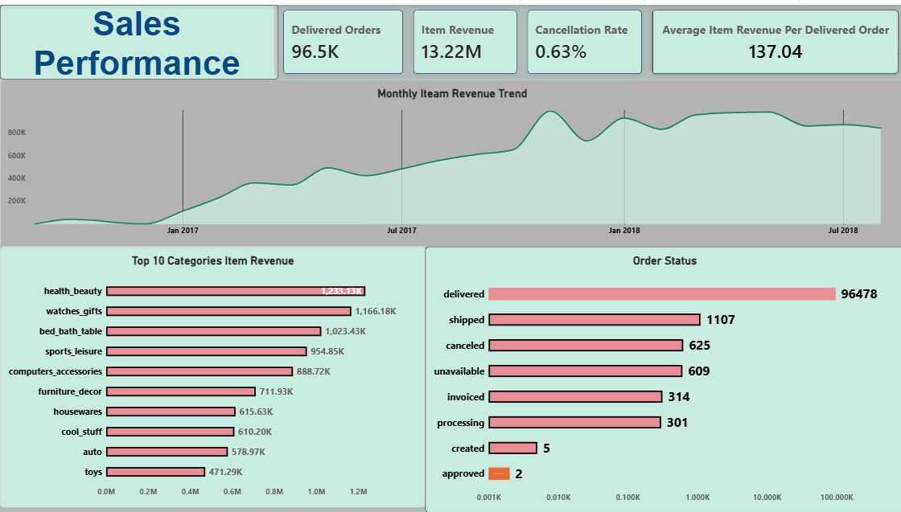
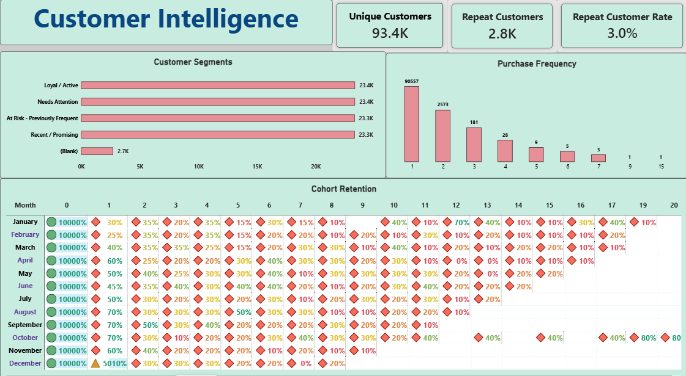
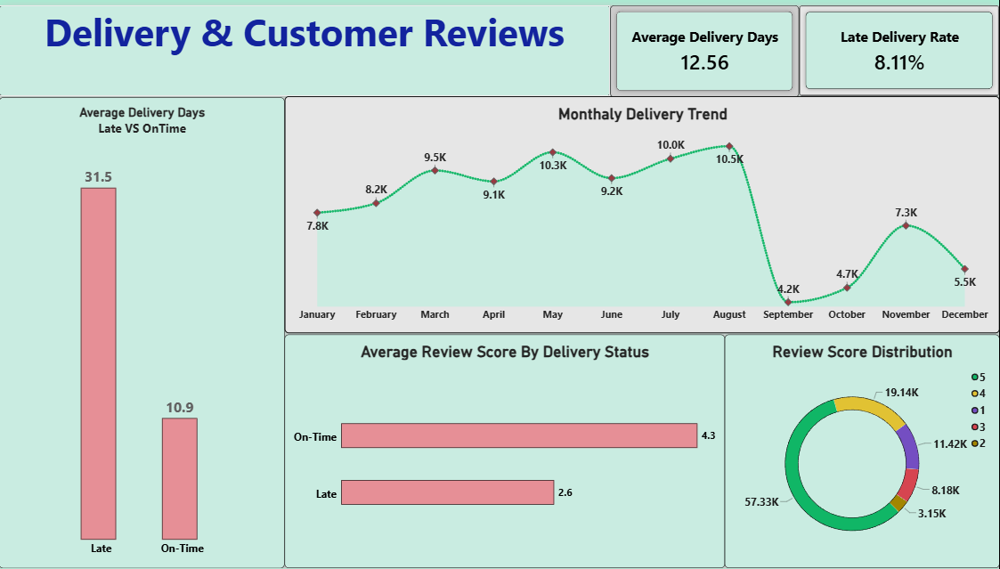

# E-Commerce Customer Intelligence & Revenue Growth

**End-to-end Data Analytics Portfolio Project**\
**Tools:** Python · SQL · Power BI · DAX\
**Dataset:** Brazilian E-Commerce Public Dataset by Olist

This project analyses e-commerce sales performance, customer purchasing
behaviour, cohort retention, delivery performance, and customer reviews.
The goal is to turn raw transactional data into business-focused metrics
and interactive Power BI dashboards.

## Dashboard Screenshots


### Page 1 --- Sales Performance



### Page 2 --- Customer Intelligence



### Page 3 --- Delivery & Customer Reviews



## Business Problem

E-commerce teams need to understand how sales change over time, which
product categories generate the most item revenue, whether customers
return to purchase again, how customer retention changes across cohorts,
and how delivery performance relates to customer reviews.

This project combines Python, SQL, and Power BI to prepare data, analyse
business questions, and present the results in a three-page interactive
report.

## Business Questions

-   How do delivered orders and item revenue change over time?
-   Which product categories contribute the most item revenue?
-   What proportion of customers make repeat purchases?
-   How does customer retention change after the first observed purchase
    month?
-   How long do delivered orders take to reach customers?
-   How do late and on-time deliveries compare?
-   How are review scores distributed, and how do they vary by delivery
    status?

## Project Workflow

1.  **Data audit and preparation --- Python:** inspect CSVs, validate
    data types, check missing values and duplicates, prepare dates, and
    create analysis-ready tables.
2.  **Business analysis --- SQL:** validate row counts and joins,
    aggregate data at the appropriate grain, and answer business
    questions with filtering, grouping, and joins.
3.  **Data modelling --- Power BI:** load prepared data, validate
    relationships, and create measures for report KPIs.
4.  **Visual analysis --- Power BI:** build three report pages covering
    sales performance, customer intelligence, and delivery/customer
    reviews.
5.  **Validation and communication:** compare key figures across tools,
    review chart behaviour, and document business implications and
    limitations.

## Power BI Report Pages

### 1. Sales Performance

The first page provides a high-level view of sales performance.

-   KPI cards: Delivered Orders, Item Revenue, Cancellation Rate, and
    Average Item Revenue per Delivered Order.
-   Monthly item-revenue trend.
-   Top 10 product categories by item revenue.
-   Order-status distribution.

**Questions it helps answer:** Which categories lead in item revenue?
How does item revenue change over time? How many orders are delivered or
cancelled?

### 2. Customer Intelligence

The second page focuses on customer purchasing behaviour and retention.

-   Unique Customers, Repeat Customers, and Repeat Customer Rate KPI
    cards.
-   Cohort retention matrix by cohort month and cohort index.
-   Customer segment visual.
-   Purchase-frequency distribution.

**Questions it helps answer:** How many customers purchase more than
once? How does retention vary by cohort? How many orders do customers
typically place?

### 3. Delivery & Customer Reviews

The third page explores delivery operations and review outcomes.

-   Average Delivery Days and Late Delivery Rate KPI cards.
-   Average delivery days: late versus on-time.
-   Monthly delivery trend.
-   Average review score by delivery status.
-   Review-score distribution.

**Questions it helps answer:** How does delivery timing vary? What
proportion of delivered orders are classified as late? How do review
scores differ across delivery statuses?

## DAX Measures Used in the Report

> The formulas below are the measure definitions supplied for this
> project. Confirm table names, column names, status spelling, and table
> grain in the final `.pbix` before publishing. Some measures depend on
> the model structure described under each heading.

### 1. Delivered Orders

``` dax
Delivered Orders =
CALCULATE(
    DISTINCTCOUNT('order_fact'[order_id]),
    'order_fact'[order_status] = "delivered"
)
```

Counts distinct orders whose status is `delivered`.

### 2. Item Revenue

``` dax
Item Revenue =
SUM('order_items'[price])
```

Sums item prices from `order_items`, assuming one row per order item.
Item revenue is **not profit** and may exclude freight. Avoid summing
repeated order-level revenue values across item rows.

### 3. Cancelled Orders

``` dax
Cancelled Orders =
CALCULATE(
    DISTINCTCOUNT('order_fact'[order_id]),
    'order_fact'[order_status] = "canceled"
)
```

Counts distinct orders with the status `canceled`. Use the exact status
value in the imported data; the spelling may differ by dataset/model.

### 4. Cancellation Rate

``` dax
Cancellation Rate =
DIVIDE(
    [Cancelled Orders],
    DISTINCTCOUNT('order_fact'[order_id]),
    0
)
```

Divides cancelled orders by distinct orders in the current filter
context. Format the measure as a percentage and keep the denominator
consistent with the stated business definition.

### 5. Average Delivered Order Item Value

``` dax
Average Delivered Order Item Value =
DIVIDE(
    [Delivered Item Revenue],
    [Delivered Orders],
    0
)
```

Divides delivered item revenue by delivered orders. This is an average
based on item revenue, not necessarily the total amount paid by a
customer, because freight/payment components may be excluded. Confirm
that `[Delivered Item Revenue]` exists as a measure and is correctly
filtered to delivered orders.

### 6. Unique Customers

``` dax
Unique Customers =
DISTINCTCOUNT('order_fact'[customer_unique_id])
```

Counts unique customers in the current filter context. The project uses
`customer_unique_id` for customer-level repeat analysis rather than
relying only on `customer_id`.

### 7. Repeat Customers

``` dax
Repeat Customers =
COUNTROWS(
    FILTER(
        'customer_order_frequency',
        'customer_order_frequency'[order_count] >= 2
    )
)
```

Counts rows in `customer_order_frequency` where `order_count` is at
least 2. This measure assumes the table has exactly one row per unique
customer and `order_count` is numeric. If there are multiple rows per
customer, validate or adjust the measure to avoid overcounting.

### 8. Repeat Customer Rate

``` dax
Repeat Customer Rate =
DIVIDE(
    [Repeat Customers],
    [Unique Customers],
    0
)
```

Divides repeat customers by unique customers. The numerator and
denominator should represent the same customer population and follow the
same order-status rules. The initial project snapshot showed 2,801
repeat customers out of 93,358 customers with delivered orders,
approximately 3.00%; revalidate these values in the final report before
quoting them.

### 9. Cohort Retention

The cohort table uses these fields:

-   `cohort_month`: the month of the customer's first observed purchase.
-   `cohort_index`: the month number relative to the cohort start.
-   `cohort_size`: number of customers in the cohort.
-   `active_customers`: customers active in that cohort period.
-   `retention_pct`: active customers divided by cohort size.

Conceptually:

``` text
retention_pct = active_customers / cohort_size
```

**Matrix setup** - Rows: `cohort_month` - Columns: `cohort_index` -
Values: `retention_pct` - Sort cohort month chronologically. - Ensure
there is one value per cohort-month-index or use an appropriate
measure. - Consider hiding totals if they average percentages in a
misleading way. - Cohort index `0` is usually the baseline month and may
show 100%, depending on the calculation.

If the stored value is `0.30`, Percentage formatting displays `30%`. Do
not multiply by 100 in DAX and also format the result as a percentage.

### 10. Average Delivery Days

``` dax
Average Delivery Days =
AVERAGEX(
    FILTER(
        'order_fact',
        NOT ISBLANK('order_fact'[order_purchase_timestamp]) &&
        NOT ISBLANK('order_fact'[order_delivered_customer_date]) &&
        'order_fact'[order_status] = "delivered"
    ),
    DATEDIFF(
        'order_fact'[order_purchase_timestamp],
        'order_fact'[order_delivered_customer_date],
        DAY
    )
)
```

Calculates the calendar-day difference between purchase and delivery,
then averages it for delivered orders with both timestamps present. If
the model already contains a validated delivery-days column, use that
instead.

### 11. Late Delivery Rate

``` dax
Late Delivery Rate =
DIVIDE(
    CALCULATE(
        DISTINCTCOUNT('order_fact'[order_id]),
        'order_fact'[is_late] = TRUE()
    ),
    [Delivered Orders],
    0
)
```

Calculates late delivered orders divided by delivered orders. This
assumes `is_late` is a Boolean field and the table is correctly
modelled. Document the late-delivery rule used, such as actual delivery
after the estimated delivery date.

## Initial Verified Dataset Snapshot

These were initial audit results from the supplied dataset. Re-run and
validate the project before using them in an interview or resume.

  -----------------------------------------------------------------------
  Metric                                                   Initial result
  ------------------------------ ----------------------------------------
  Distinct orders                                                  99,441

  Delivered orders                                                 96,478

  Cancelled orders                                                    625

  Cancellation rate                                                 0.63%

  Delivered item revenue                                    13,221,498.11

  Average delivered order item                                     137.04
  value                          

  Customers with delivered                                         93,358
  orders                         

  Repeat customers                                                  2,801

  Repeat-customer rate                                              3.00%

  Highest item-revenue category                           `health_beauty`
  in the initial snapshot        

  Month with highest                                            `2017-11`
  delivered-order count in the   
  initial snapshot               
  -----------------------------------------------------------------------

Revenue uses item `price` and excludes freight; it is not profit.
Currency should be labelled only after confirming the dataset's
currency.

## Key Data Quality and Modelling Decisions

-   Use `customer_unique_id` for repeat-customer analysis.
-   Do not join raw order-item rows directly to raw payment rows and
    then sum both: multiple items and multiple payments can multiply
    records and inflate totals. Aggregate each to order-level first.
-   Validate relationships and table grain before creating measures.
-   Ensure measures count distinct orders where appropriate.
-   Ensure percentage measures are stored/formatted consistently.
-   Compare Python, SQL, and Power BI results using matching filters and
    definitions.

## Visual Design Choices

  -----------------------------------------------------------------------
  Business question       Visual                  Reason
  ----------------------- ----------------------- -----------------------
  How does item revenue   Line/area trend         Shows change over time
  change over time?                               

  Which categories rank   Sorted horizontal bar   Easy category
  highest?                chart                   comparison

  How are order statuses  Bar chart               Compares statuses
  distributed?                                    clearly

  How does retention      Matrix with conditional Shows two-dimensional
  change across cohorts?  formatting              retention patterns

  How many customers      Column/bar chart        Compares
  place 1, 2, 3+ orders?                          purchase-frequency
                                                  groups

  How do late and on-time Bar/column chart        Direct comparison
  delivery days compare?                          

  How are review scores   Bar chart or donut      Shows counts or broad
  distributed?                                    composition
  -----------------------------------------------------------------------

## Business Interpretation and Limitations

Use the visuals to investigate trends and formulate recommendations,
then verify each claim against the data. Do not imply causation from
correlations.

-   The dataset does not contain complete website clickstream events, so
    this project does **not** claim to measure a true visitor →
    add-to-cart → checkout → purchase funnel.
-   Item `price` is not profit and excludes freight.
-   Product cost/margin fields are not available, so reliable profit
    cannot be calculated.
-   Delivery/review relationships are descriptive and do not prove that
    delivery timing caused a review score.
-   The dataset is historical; trends describe the available data period
    rather than current market conditions.

## Repository Structure

Adapt this outline to match the actual folders in your repository:

``` text
ecommerce-customer-intelligence/
├── data/
│   ├── raw/
│   └── processed/
├── Notebook/
├── Sql_Analysis/
├── powerbi/
│   ├── Ecommerce Analysis.pbix
│   └── screenshots/
│       ├── 01_sales_performance.png
│       ├── 02_customer_intelligence.png
│       └── 03_delivery_customer_reviews.png
├── README.md
└── requirements.txt
```

## How to Reproduce

1.  Open the Python notebooks and run cells in order, updating file
    paths if needed.
2.  Import the required CSV files into MySQL Workbench and run the SQL
    validation and analysis scripts.
3.  Open the `.pbix` file in Power BI Desktop.
4.  Refresh data sources and verify relationships and DAX measures.
5.  Test filters, cross-highlighting, cohort matrix values, and KPI
    totals.
6.  Export each report page and add the PNGs to `powerbi/screenshots/`.

## Dataset Attribution

## 📂 Dataset

This project uses the **Brazilian E-Commerce Public Dataset by Olist**, which contains anonymized e-commerce order, customer, product, seller, payment, review, and delivery information.

**Dataset source:** [Olist Brazilian E-Commerce Dataset — Kaggle](https://www.kaggle.com/datasets/olistbr/brazilian-ecommerce)

### Dataset Files

The original dataset contains nine CSV files:

- `olist_customers_dataset.csv` — Customer identifiers and location information.
- `olist_geolocation_dataset.csv` — Brazilian ZIP-code geolocation data.
- `olist_order_items_dataset.csv` — Order items, product prices, freight values, and sellers.
- `olist_order_payments_dataset.csv` — Payment methods, installments, and payment amounts.
- `olist_order_reviews_dataset.csv` — Customer review scores and review comments.
- `olist_orders_dataset.csv` — Order status and purchase, approval, shipping, and delivery timestamps.
- `olist_products_dataset.csv` — Product attributes and category information.
- `olist_sellers_dataset.csv` — Seller identifiers and location information.
- `product_category_name_translation.csv` — Portuguese-to-English product category translations.

### How to Get the Data

1. Open the Kaggle dataset link above.
2. Sign in to Kaggle and download the dataset.
3. Extract the CSV files.
4. Place them in the project's `data/raw/` directory, or update the file paths in the notebooks to match your local folder structure.
5. Follow the instructions in the notebooks and SQL scripts to prepare and analyze the data.

**Note:** The raw CSV files are not included in this GitHub repository because of their size. Download the original dataset from Kaggle to reproduce the analysis.

### Data Limitations

- The dataset does not contain complete website clickstream events, so this project analyzes order and purchase behavior rather than a true website visitor-to-purchase funnel.
- Item revenue is based on product prices and should not be interpreted as profit.
- The dataset is historical; seasonal patterns describe the available period and do not guarantee future trends.
- Relationships between delivery performance and review scores should be interpreted as associations, not proof of causation.


## Author

**Dharmveer Patel**\
Aspiring Data Analyst · Python · SQL · Power BI · DAX

-   GitHub: https://github.com/dharmveer04
-   LinkedIn: https://www.linkedin.com/in/dharmveer-patel-b3188b348
